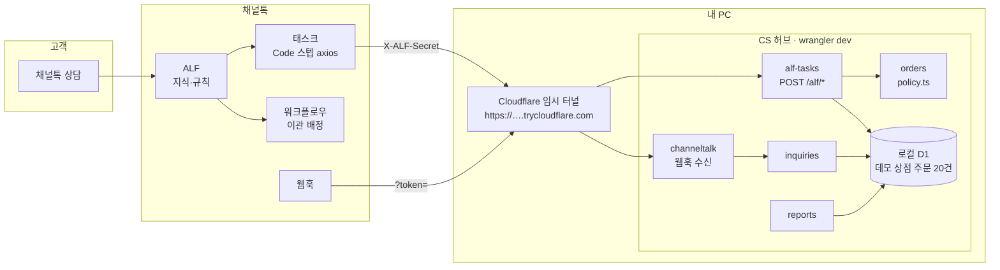
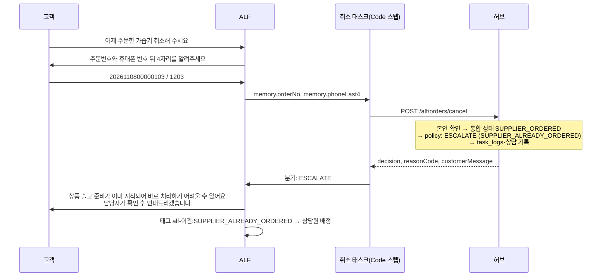

# 쏙골라마켓 CS 자동화 허브

> 네이버 스마트스토어·쿠팡 위탁판매 상점의 고객 문의를 **채널톡 ALF**가 끝까지 처리할 수 있도록,
> 판매채널 주문 ↔ 공급처 발주 ↔ 송장을 하나로 묶어 ALF 태스크에 판단 결과를 돌려주는 API 허브

   

**이 저장소가 보여주는 것**: 채널톡 ALF의 **지식 · 규칙 · 태스크(Code 스텝) · 워크플로우 · 웹훅**을 직접 설계해 외부 시스템과 연동하고,
테스트 문의 세트와 운영 리포트로 v1 → v2 튜닝을 측정하는 과정.

## 1. 문제 — 위탁판매 CS는 왜 어려운가

위탁판매는 **고객이 보는 주문과 실제로 상품이 움직이는 주문이 다르다.**
고객은 스마트스토어·쿠팡에서 주문하고, 판매자는 그 주문을 공급처에 대신 발주하며, 송장은 공급처가 낸다.

그래서 "취소해 주세요"라는 같은 문의도 답이 세 가지다.

| 주문 상태 | 올바른 답 | ALF가 지식만 보고 답하면 |
|---|---|---|
| 공급처 발주 **전** | 앱에서 바로 취소 가능 | ✓ |
| 공급처 발주 **후**, 출고 전 | 공급처 출고 중지 확인이 필요 → 담당자 확인 | ✗ "바로 취소됩니다" (실제로는 출고되어 클레임) |
| 출고 후 | 취소 불가, 받은 뒤 반품 | ✗ |

판단에 필요한 "발주했는가"는 **판매채널 API에도 채널톡에도 없다.** 이 허브가 그 정보를 모아
ALF 태스크가 한 번 호출로 `ALLOW / ESCALATE / DENY`와 **고객에게 그대로 보낼 문장**을 받게 한다.
상담 이벤트도 함께 쌓아 ALF 해결률·이관 사유·문의가 많은 상품을 리포트로 만든다.

## 2. 아키텍처



**운영 형태**: 채널톡 연동을 보여주는 것이 목적이라 서버를 상시 운영하지 않는다.
허브는 내 PC에서 `wrangler dev`로 띄우고, **Cloudflare 임시 터널**(계정 불필요·무료)로 채널톡이 접근할 HTTPS 주소를 연다.
주문 데이터는 실제 고객 정보 대신 **데모 상점 주문 20건(mock)**을 쓴다. 같은 코드를 `wrangler deploy`하면 무료 Workers에 그대로 올라간다.

| 설계 결정 | 이유 |
|---|---|
| ALF 요청 때 외부 API를 부르지 않고 D1에 모아 둔 값을 읽는다 | 채널톡 Code 스텝은 60초 제한. 요청 처리는 D1 조회 몇 번 |
| 정책은 `orders/policy.ts` **순수 함수 + 상태×액션 표** 하나 | 운영자가 표만 보고 이해·수정. 36칸 전부 테스트 |
| ALLOW여도 판매채널 API로 취소하지 않고 **고객이 직접 처리하도록 안내** | 판매자 API 취소는 쿠팡 판매자 점수 하락(공식 문서). 배송지 변경 API는 없음 |
| 본인 확인은 **주문번호 + 휴대폰 뒤 4자리 둘 다** | 뒤 4자리 단독 조회는 1만 가지 조합뿐 |
| 응답 HTTP 규칙: 판단 결과는 200, 연동 문제만 4xx/5xx | Code 스텝의 "요청 실패 시" 분기를 연동 장애에만 쓰게 한다 |
| 외부 API는 `adapters/` 뒤에, 기본값 mock | 키 없이 `npm run dev` 하나로 전체 흐름이 돈다 |

자세한 내용: [`docs/architecture.md`](docs/architecture.md) (정책 표, 스키마, 외부 API 확인 현황, 결정 기록)

## 3. 채널톡 세팅 요약

| 구성 | 내용 | 문서 |
|---|---|---|
| **지식** | 공통 FAQ + 스마트스토어/쿠팡 **채널별** 배송·교환·반품 정책 5개. 원문에서 운영자 메모를 지우고 금지어(공급처·도매·발주 등)를 검사해 빌드 | [01-knowledge](docs/channeltalk/01-knowledge.md) |
| **규칙** | 주문 문의는 반드시 태스크로 확인 · 판매채널 먼저 확인 · 도착일·보상 약속 금지 · 불만·불량은 즉시 이관 등 13개, 규칙마다 막으려는 실패를 기록 | [02-rules](docs/channeltalk/02-rules.md) |
| **태스크** | 연결 확인 + 주문 조회 · 취소 · 배송지 변경 · 반품 접수. AI Agent(정보 수집) → Code(허브 호출) → decision 분기 → 메시지 / 이관 태그. Code 스텝 코드는 `npm run task-code`가 생성 | [03-tasks](docs/channeltalk/03-tasks.md) |
| **워크플로우** | 운영 시간 안내 · `alf-이관:<사유>` 태그 기반 상담원 배정 · 종료 후 만족도 | [04-workflows](docs/channeltalk/04-workflows.md) |
| **웹훅** | 상담·메시지 이벤트 → 상담 로그. 상담원 메시지로 이관 판별, 태스크 결과와 chatId로 연결 | [architecture §6](docs/architecture.md#6-채널톡-연동) |

<!-- screenshot: ALF 지식 폴더 구조 -->
<!-- screenshot: ALF 규칙 설정 화면 -->
<!-- screenshot: 취소 태스크 편집 화면(스텝·분기) -->
<!-- screenshot: 이관 배정 워크플로우 -->
<!-- screenshot: 실제 상담에서 취소 태스크가 이관되는 대화 -->

## 4. 태스크 시나리오 예시

**"어제 주문한 가습기 취소해 주세요"** — 공급처에 이미 발주한 주문



같은 문의라도 주문 상태에 따라 결과가 달라진다.

| 주문 상태 | decision | 고객에게 나가는 문장(허브가 생성) |
|---|---|---|
| 발주 전 | `ALLOW` | 아직 상품 준비 전이라 바로 취소하실 수 있어요. 네이버페이 주문내역에서 '취소 요청'을 눌러 주시면 즉시 처리됩니다. |
| 발주 후 | `ESCALATE` | 상품 출고 준비가 이미 시작되어 바로 처리하기 어려울 수 있어요. 담당자가 확인 후 안내드리겠습니다. |
| 출고 후 | `DENY` | 상품이 이미 출고되어 취소나 배송지 변경이 어려워요. 받으신 뒤 반품 신청을 해주세요. 배송 조회: CJ대한통운 … |

`customerMessage`는 **공급처 정보·도착 예정일을 절대 담지 않는다** — 데모 주문 20건 × 액션 4개 × 반품 사유 4개의 모든 문장을 테스트로 검사한다.

## 5. 운영 고도화 기록 (v1 → v2)

평가 세트: [`docs/test-scenarios.md`](docs/test-scenarios.md) 30문항(단순 FAQ 8 · 태스크 필요 12 · 이관해야 정상 6 · 범위 밖 4). 이 중 허브 판단이 필요한 18문항의 기대 결과는 테스트로 고정되어 있다.
지표: `npm run report`(ALF 해결률, 이관 사유, 태스크별 판단, 상품별 문의). 실패 사례와 수정 내용: [`05-tuning-log`](docs/channeltalk/05-tuning-log.md).

| 버전 | 테스트 정답률(30) | A FAQ(8) | B 태스크(12) | C 이관(6) | D 범위 밖(4) | 주요 변경 |
|---|---|---|---|---|---|---|
| v1 | | | | | | 최초 설정 |
| v2 | | | | | | |

<!-- screenshot: npm run report 출력 -->

## 6. 실행

Node 24 이상. 키가 없어도 된다.

```bash
npm install
npm run setup               # .dev.vars에 무작위 시크릿 생성
npm run db:migrate          # 로컬 D1
npm run seed                # 데모 상점 주문 20건(주문번호·뒤4자리 목록 출력)
npm run dev                 # http://localhost:8787
```

```bash
S=$(grep ALF_SECRET .dev.vars | cut -d= -f2)

# 주문 조회 — 배송 중
curl -s -X POST localhost:8787/alf/orders/lookup \
  -H 'Content-Type: application/json' -H "X-ALF-Secret: $S" \
  -d '{"orderNo":"2026110600000106","phoneLast4":"1206","chatId":"demo-chat-1"}'
# → {"ok":true,"decision":"INFO","reasonCode":"STATUS_SHIPPING",
#    "customerMessage":"상품이 출고되어 배송 중이에요. 배송 조회: 롯데택배 500000000006","data":{...}}

# 취소 — 공급처 발주 후라 사람 확인
curl -s -X POST localhost:8787/alf/orders/cancel \
  -H 'Content-Type: application/json' -H "X-ALF-Secret: $S" \
  -d '{"orderNo":"2026110800000103","phoneLast4":"1203"}'
# → {"ok":true,"decision":"ESCALATE","reasonCode":"SUPPLIER_ALREADY_ORDERED", ...}

# 반품 — 배송완료 1일, 단순 변심
curl -s -X POST localhost:8787/alf/orders/return-request \
  -H 'Content-Type: application/json' -H "X-ALF-Secret: $S" \
  -d '{"orderNo":"3000000000205","phoneLast4":"2205","reason":"CHANGE_OF_MIND"}'
# → {"ok":true,"decision":"ALLOW","reasonCode":"RETURN_WITHIN_WINDOW", ...}

npm run report              # 운영 리포트(마크다운 표)
```

**채널톡과 연결하기** (자세히: [`docs/setup-guide.md`](docs/setup-guide.md))

```bash
brew install cloudflared                          # 처음 한 번
npm run tunnel                                    # 다른 터미널 → https://….trycloudflare.com 주소 출력
npm run task-code -- --url https://….trycloudflare.com
# → 웹훅 URL과 태스크 Code 스텝 코드 5개(dist/channeltalk/)를 주소·시크릿을 채워 생성
```

| HTTP | 의미 | ALF 태스크 처리 |
|---|---|---|
| 200 | 판단 결과(주문 없음 `ORDER_NOT_FOUND` 포함) | `decision`·`reasonCode`로 분기 |
| 400 / 401 / 5xx | 연동 문제 | Code 스텝 "요청 실패 시" 분기 → 상담원 연결 |

```bash
npm test             # 178개: 정책 표 전체, 고객 문장 규칙, API 통합, 웹훅, 리포트, 동기화, 브릿지, 어댑터, 생성 코드
npm run typecheck
npm run lint
npm run check:public # 공개 전 민감정보 검사(CI에서도 실행)
```

## 7. 확장 포인트

**새 판매채널 추가** (예: 11번가)
1. `src/adapters/sales-channel/<채널>.ts`에 `SalesChannelAdapter`를 구현한다. 외부 상태값을 통합 상태(`OrderStatus`)로, 이름·전화번호를 마스킹 값으로 바꾸는 일은 어댑터 안에서 끝낸다.
2. `src/modules/orders/types.ts`의 `CHANNELS`와 마이그레이션의 `channel` CHECK 제약에 채널을 추가한다.
3. `messages.ts`의 `SELF_SERVICE`에 고객이 직접 처리하는 메뉴 위치를 넣는다(빠뜨리면 타입 오류).
4. `src/app/container.ts`에서 어댑터를 고른다. 도메인·정책 코드는 바꾸지 않는다.
5. 지식 원문 `docs/knowledge-source/<채널>/`을 추가한다.

**새 태스크 추가** (예: 교환 접수)
1. `orders/types.ts`의 `ACTIONS`에 액션을 추가하면 `policy.ts`의 `RULES` 표에 빈칸이 생겨 타입 오류가 난다 → 상태별 판단을 채운다.
2. 새 사유 코드의 고객 문장을 `messages.ts`에 추가한다(빠뜨리면 타입 오류). 문장 규칙 테스트가 새 조합을 자동으로 검사한다.
3. `alf-tasks/schemas.ts`·`routes.ts`에 엔드포인트를, `scripts/lib/task-code.ts`의 `TASKS`에 Code 스텝을 추가한다.
4. `docs/channeltalk/03-tasks.md`에 트리거·분기를 적고 채널톡에 태스크를 만든다.

**실제 주문 연결**: `DATA_SOURCE=live`는 위탁판매 운영 시스템([coupang-dropship-engine](https://github.com/lirongzzuin/coupang-dropship-engine-public))에서 주문을 읽는 어댑터로 설계만 해 두었다(엔진 쪽 API는 미구현, 계약은 `src/adapters/engine-client.ts`). 쿠팡 API는 허용 IP에서만 호출되는데 Workers는 IP가 고정되지 않아 직접 호출 대신 엔진을 거친다.

## 프로젝트 구조

```
src/
  index.ts            라우트 마운트 + cron 연결(로직 없음)
  app/                env 해석 · 컨테이너(조립) · 공통 에러 · 마스킹 로거 · 시크릿 비교 · cron 작업 목록
  modules/
    orders/           통합 주문 · policy.ts(상태×액션 표) · 고객 문장 · D1 레포지토리
    alf-tasks/        ALF 태스크 API · 연결 확인(ping) · X-ALF-Secret · zod 계약 · task_logs
    channeltalk/      웹훅(token 검증·정규화·필드 구조 기록) · Open API 클라이언트(인터페이스+mock)
    inquiries/        상담 로그 · 태스크 결과 연결 · 쿠팡 문의 브릿지(플래그, 기본 off)
    reports/          운영 지표 · 마크다운 표
    sync/             판매채널·공급처 증분 동기화(cron)
  adapters/           데모 상점(mock) · 엔진 연동(설계) · 쿠팡/스마트스토어 직접 호출 참고 구현
migrations/           D1 SQL
scripts/              setup · seed · task-code · report · build-knowledge · check-public
docs/                 architecture · channeltalk/01~05 · knowledge-source · test-scenarios · setup-guide
tests/                Workers 런타임(Miniflare) 위에서 D1까지 실제로 돌리는 테스트
```

## 외부 API를 다룬 원칙

- 엔드포인트·필드명·인증 방식을 추측해서 쓰지 않았다. 공식 문서로 확인한 것은 코드 주석에 URL과 확인일을 남겼고, 확인하지 못한 것은 `TODO(verify-api)`로 표시했다(`grep -rn "TODO(verify-api)" src`).
- 문서로 확인할 수 없던 채널톡 값(웹훅 필드 이름, Code 스텝의 상담 ID 경로)은 **실제 연동에서 확인하는 장치**를 넣었다: 웹훅 키 구조 로그(`WEBHOOK_DEBUG`), 받은 chatId를 그대로 돌려주는 연결 확인 태스크(`/alf/ping`).
- 확인 현황 표: [`docs/architecture.md` §8](docs/architecture.md#8-외부-api-확인-현황)
- 개인정보: 전화번호 전체·실명·주소 원문은 저장하지 않는다. 로그는 전화번호·이름·주소 패턴을 한 번 더 마스킹한다. 테스트·문서의 주문 정보는 모두 가짜다.
