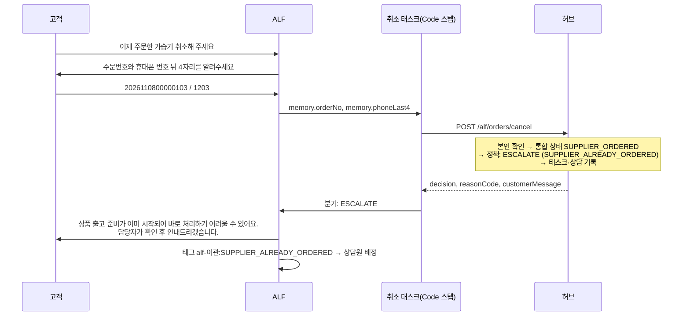
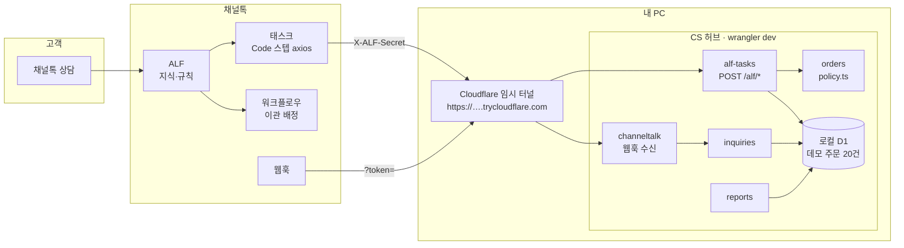

# 쏙골라마켓 CS 자동화 허브

> 네이버 스마트스토어·쿠팡에서 위탁판매를 하며 반복되던 고객 문의를 **채널톡 ALF**가 끝까지 처리할 수 있게,
> 주문·발주·송장 상태를 모아 ALF 태스크에 "이 문의를 어떻게 처리해야 하는지"를 돌려주는 작은 API 허브

   

## 만든 계기

쏙골라마켓은 스마트스토어와 쿠팡에서 생활용품을 위탁판매로 운영하는 작은 상점이다. 주문 수집과 발주는 직접 만든 운영 시스템([coupang-dropship-engine](https://github.com/lirongzzuin/coupang-dropship-engine-public))으로 어느 정도 자동화했지만, 고객 문의는 여전히 손으로 답하고 있었다.

자주 오는 문의는 "언제 와요", "취소해 주세요", "주소 바꿀래요", "반품할게요" 같은 것들이었다. 그런데 이 문의들은 FAQ로 답하면 오히려 사고가 나는 종류였다. 같은 "취소해 주세요"라도 공급처에 이미 발주했는지에 따라 답이 완전히 달라지기 때문이다.

AI 상담에 관심을 갖고 지켜보던 차에, 채널톡 ALF가 지식·규칙 외에 **태스크(Code 스텝)로 외부 시스템을 호출**할 수 있다는 걸 알게 됐다. "주문 상태를 보고 판단하는 부분만 내가 API로 만들어 주면, 나머지 대화는 ALF에 맡길 수 있지 않을까?" 하는 생각으로 시작한 프로젝트다.

이 저장소에는 그 과정에서 만든 것들이 함께 들어 있다.
- 허브 코드
- 채널톡에 넣은 지식·규칙·태스크·워크플로우 설계 문서
- 결과를 재기 위한 테스트 문의 30개와 운영 리포트

## 1. 문제 — 위탁판매 CS는 왜 FAQ로 안 되는가

위탁판매에서는 **고객이 보는 주문과 실제로 상품이 움직이는 주문이 다르다.**
고객은 스마트스토어·쿠팡에서 주문하고, 판매자는 그 주문을 공급처에 대신 발주한다. 송장도 공급처가 낸다.

| 주문 상태 | 올바른 답 | ALF가 지식만 보고 답하면 |
|---|---|---|
| 공급처 발주 **전** | 앱에서 바로 취소 가능 | ✓ |
| 공급처 발주 **후**, 출고 전 | 공급처에 출고 중지를 확인해야 함 → 담당자 확인 | ✗ "바로 취소됩니다" (실제로는 출고되어 클레임이 생김) |
| 출고 후 | 취소 불가, 받은 뒤 반품 | ✗ |

판단에 필요한 "발주했는가"는 **판매채널 API에도, 채널톡에도 없다.** 그래서 이 정보를 한곳에 모으는 허브를 만들었다. ALF 태스크는 허브를 한 번 호출해 아래 두 가지를 받는다.

- 판단 결과: `ALLOW`(허용), `DENY`(거절), `ESCALATE`(담당자 확인), `INFO`(정보 안내)
- 고객에게 그대로 보낼 문장

허브는 상담 이벤트도 함께 쌓는다. 이를 바탕으로 ALF 해결률, 이관 사유, 문의가 많은 상품을 리포트로 만든다.

## 2. 채널톡에서 설계한 것

실제 상점의 상담 흐름을 ALF의 구성 요소에 하나씩 나눠 담았다.

| 구성 | 한 일 | 문서 |
|---|---|---|
| **지식** | 공통 FAQ와 스마트스토어·쿠팡의 **채널별** 배송·교환·반품 정책, 5개 문서 | [01-knowledge](docs/channeltalk/01-knowledge.md) |
| **규칙** | 13개. 규칙마다 어떤 실패를 막으려는지 적었다 | [02-rules](docs/channeltalk/02-rules.md) |
| **태스크** | 연결 확인 1개 + 주문 태스크 4개(조회·취소·배송지 변경·반품 접수) | [03-tasks](docs/channeltalk/03-tasks.md) |
| **워크플로우** | 운영 시간 안내, `alf-이관:<사유>` 태그 기반 상담원 배정, 종료 후 만족도 조사 | [04-workflows](docs/channeltalk/04-workflows.md) |
| **웹훅** | 상담·메시지 이벤트를 상담 로그로 저장. 상담원 개입 여부로 이관을 판별하고, 태스크 결과와 상담 ID로 연결 | [architecture §6](docs/architecture.md#6-채널톡-연동) |

각 구성의 세부 내용은 다음과 같다.

**지식**
- 운영자용 원문에서 내부 메모를 지운다.
- 금지어(공급처·도매·발주 등)가 남지 않았는지 검사한 뒤 업로드용으로 빌드한다.

**규칙**
- 주문 문의는 반드시 태스크로 확인한다.
- 판매채널을 먼저 확인한다.
- 도착일과 보상은 약속하지 않는다.
- 불만이나 불량 문의는 바로 상담원에게 넘긴다.

**태스크**
- 흐름: AI Agent가 정보를 모으고 → Code 스텝이 허브를 호출하고 → 판단 결과로 분기해 → 메시지를 보내거나 이관 태그를 붙인다.
- Code 스텝 코드는 `npm run task-code`로 생성한다.

설계할 때 기준으로 삼은 것:
- **사람에게 넘길 문의를 정확히 넘기기.** 모든 문의를 ALF가 끝내는 것보다 이게 먼저다. 이관할 때는 사유 코드를 태그로 남겨 상담원이 다시 묻지 않게 했다.
- **고객 문장은 허브가 만들고 ALF는 그대로 전달하기.** 공급처 이름, 매입 정보, 근거 없는 도착일이 문장에 섞이지 않도록 테스트로 막았다.
- **본인 확인은 최소 정보로.** 주문번호와 휴대폰 뒤 4자리만 받는다. 전체 번호, 이름, 주소는 묻지 않는다.

<!-- screenshot: ALF 지식 폴더 구조 -->
<!-- screenshot: ALF 규칙 설정 화면 -->
<!-- screenshot: 취소 태스크 편집 화면(스텝·분기) -->
<!-- screenshot: 이관 배정 워크플로우 -->

## 3. 대화 예시 — 이미 발주한 주문의 취소 문의



같은 문의라도 주문 상태에 따라 결과가 달라진다.

| 주문 상태 | 판단 | 고객에게 나가는 문장(허브가 생성) |
|---|---|---|
| 발주 전 | `ALLOW` | 아직 상품 준비 전이라 바로 취소하실 수 있어요. 네이버페이 주문내역에서 '취소 요청'을 눌러 주시면 즉시 처리됩니다. |
| 발주 후 | `ESCALATE` | 상품 출고 준비가 이미 시작되어 바로 처리하기 어려울 수 있어요. 담당자가 확인 후 안내드리겠습니다. |
| 출고 후 | `DENY` | 상품이 이미 출고되어 취소나 배송지 변경이 어려워요. 받으신 뒤 반품 신청을 해주세요. 배송 조회: CJ대한통운 … |

`ALLOW`라도 허브가 판매채널 API로 직접 취소하지는 않는다. 판매자가 API로 취소하면 쿠팡에서는 판매자 점수가 깎이기 때문이다. 대신 고객이 앱에서 직접 처리하는 위치를 안내한다.

## 4. 측정과 튜닝 (v1 → v2)

ALF는 한 번 설정하고 끝나는 게 아니라, 실패한 상담을 보고 고쳐 가는 과정이 필요하다고 생각했다. 그래서 측정하는 방법부터 정해 두었다.

**평가 세트:** [`docs/test-scenarios.md`](docs/test-scenarios.md)의 30문항

| 유형 | 문항 수 | 정상인 결과 |
|---|---|---|
| 단순 FAQ | 8 | 지식으로 답하고 태스크는 부르지 않는다 |
| 태스크 필요 | 12 | 주문을 확인하고 허브 판단대로 답한다 |
| 이관해야 정상 | 6 | ALF가 끝내면 실패로 본다 |
| 범위 밖 | 4 | 정중하게 상담 범위를 안내한다 |

- 이 중 허브 판단이 필요한 18문항은 기대 결과를 자동 테스트로 고정했다.

**운영 지표:** `npm run report`로 아래 항목을 집계한다.
- ALF 해결률과 이관율
- 이관 사유 분포
- 태스크별 판단 분포
- 상품별 문의 수

**실패 기록:** [`05-tuning-log`](docs/channeltalk/05-tuning-log.md)에 남긴다.
- 실패 원인은 지식 누락, 규칙 모호, 트리거 누락, 분기 오류, 허브 정책 중 하나로 나눈다.
- 무엇을 고쳤고 결과가 어떻게 바뀌었는지 함께 적는다.

| 버전 | 테스트 정답률(30) | 단순 FAQ(8) | 태스크 필요(12) | 이관해야 정상(6) | 범위 밖(4) | 주요 변경 |
|---|---|---|---|---|---|---|
| v1 | 채점 진행 중 | | | | | 최초 설정 |
| v2 | | | | | | |

<!-- screenshot: npm run report 출력 -->

## 5. 구조



채널톡과의 연동을 확인하는 것이 목적이라 서버를 상시 운영하지는 않는다.
- 허브는 내 PC에서 `wrangler dev`로 실행한다.
- 채널톡이 접근할 HTTPS 주소는 Cloudflare 임시 터널(무료, 계정 불필요)로 연다.
- 주문 데이터는 실제 고객 정보 대신 **데모 주문 20건**을 쓴다.
- 같은 코드를 `wrangler deploy`하면 무료 Workers에 그대로 올릴 수 있다.

| 설계 결정 | 이유 |
|---|---|
| ALF 요청 때 외부 API를 부르지 않고, 미리 모아 둔 D1 값을 읽는다 | Code 스텝은 실행 시간 제한이 있고 상담 응답은 빨라야 한다 |
| 정책은 `orders/policy.ts` 하나에 **상태×액션 표**로 둔다 | 운영자가 표만 보고 이해하고 고칠 수 있다. 36칸 전부 테스트한다 |
| 판단 결과는 HTTP 200, 연동 문제만 4xx/5xx로 응답한다 | Code 스텝의 "요청 실패 시" 분기를 연동 장애에만 쓰게 한다 |
| 본인 확인은 주문번호와 휴대폰 뒤 4자리를 **둘 다** 받는다 | 뒤 4자리만으로는 1만 가지 조합뿐이다 |
| 외부 API는 `adapters/` 뒤에 두고 기본값은 mock으로 한다 | 키가 없어도 `npm run dev` 하나로 전체 흐름이 돈다 |

자세한 설계는 [`docs/architecture.md`](docs/architecture.md)에 있다(정책 표, 스키마, 외부 API 확인 현황, 결정 기록 D1~D18, 알려진 한계).

## 6. 실행해 보기

Node 24 이상이 필요하다. API 키는 없어도 된다.

```bash
npm install
npm run setup               # .dev.vars에 무작위 시크릿 생성
npm run db:migrate          # 로컬 D1
npm run seed                # 데모 주문 20건(주문번호·뒤4자리 목록 출력)
npm run dev                 # http://localhost:8787
```

```bash
S=$(grep ALF_SECRET .dev.vars | cut -d= -f2)

# 주문 조회 — 배송 중
curl -s -X POST localhost:8787/alf/orders/lookup \
  -H 'Content-Type: application/json' -H "X-ALF-Secret: $S" \
  -d '{"orderNo":"2026110600000106","phoneLast4":"1206","chatId":"demo-chat-1"}'
# → {"ok":true,"decision":"INFO","reasonCode":"STATUS_SHIPPING",
#    "customerMessage":"상품이 출고되어 배송 중이에요. 배송 조회: 롯데택배 500000000006","data":{...}}

# 취소 — 공급처 발주 후라 담당자 확인
curl -s -X POST localhost:8787/alf/orders/cancel \
  -H 'Content-Type: application/json' -H "X-ALF-Secret: $S" \
  -d '{"orderNo":"2026110800000103","phoneLast4":"1203"}'
# → {"ok":true,"decision":"ESCALATE","reasonCode":"SUPPLIER_ALREADY_ORDERED", ...}

npm run report              # 운영 리포트(마크다운 표)
```

**채널톡과 연결하기**

순서대로 따라 할 수 있는 안내는 [`docs/setup-guide.md`](docs/setup-guide.md)에 있다.

```bash
brew install cloudflared                          # 처음 한 번
npm run tunnel                                    # 다른 터미널 → https://….trycloudflare.com
npm run task-code -- --url https://….trycloudflare.com
# → 웹훅 URL과 태스크 Code 스텝 코드 5개를 주소·시크릿을 채워 dist/channeltalk/에 생성
```

```bash
npm test             # 178개: 정책 표 전체, 고객 문장 규칙, API 통합, 웹훅, 리포트, 동기화, 생성 코드
npm run typecheck
npm run lint
npm run check:public # 공개 전 민감정보 검사(CI에서도 실행)
```

## 7. 만들면서 알게 된 것

- **문서로 확인할 수 없는 부분이 생각보다 많았다.** 공식 문서에서 찾지 못한 것은 세 가지다.
  - 웹훅 본문의 정확한 필드 이름
  - Code 스텝 `context` 안에서 상담 ID가 있는 위치
  - Code 스텝에서 시크릿을 따로 보관하는 방법

  이런 값은 추측해서 코드에 쓰지 않았다. 대신 실제 연동에서 확인할 수 있는 장치를 넣었다.
  - 웹훅 본문의 키 구조만(값은 빼고) 남기는 로그(`WEBHOOK_DEBUG`)
  - 받은 상담 ID를 그대로 돌려주는 연결 확인 태스크(`/alf/ping`)
- **"ALF에 무엇을 맡기지 않을지"를 먼저 정해야 했다.** 위탁판매에서는 잘못 안내한 취소 하나가 클레임으로 이어진다. 그래서 이관 기준을 먼저 정하고, 판단은 ALF가 아닌 정책 표에 두었다.
- **"요청 실패"와 "주문 없음"을 구분해야 분기가 깔끔해졌다.** 허브가 주문을 못 찾았을 때 404로 응답하면 Code 스텝의 실패 분기로 빠진다. 그러면 연동 장애와 고객의 오타를 구분할 수 없다. 그래서 판단 결과는 모두 200으로 응답하도록 계약을 정했다.
- 쿠팡 상품 문의를 채널톡 상담으로 가져와 ALF가 답하게 하는 브릿지도 설계했다(기본 꺼짐). 다만 Open API로 만든 상담에 ALF가 반응하는지는 확인하지 못해 인터페이스와 mock까지만 구현했다. 확인할 항목은 [03-tasks 체크리스트](docs/channeltalk/03-tasks.md)에 정리했다.

## 8. 확장할 때

**새 판매채널 추가** (예: 11번가)
- 어댑터 하나(`src/adapters/sales-channel/<채널>.ts`)를 구현한다.
- 고객이 직접 처리하는 메뉴 위치를 `messages.ts`에 추가한다. 빠뜨리면 타입 오류가 나서 놓칠 수 없다.
- 도메인·정책 코드는 바꾸지 않는다.

**새 태스크 추가** (예: 교환 접수)
- `ACTIONS`에 액션을 추가하면 정책 표에 빈칸이 생겨 타입 오류가 난다. 상태별 판단을 채우면 된다.
- 고객 문장 규칙 테스트는 새 조합까지 자동으로 검사한다.

**실제 주문 연결**
- `DATA_SOURCE=live`는 위탁판매 운영 시스템에서 주문을 읽는 어댑터로 설계만 해 두었다. 계약은 `src/adapters/engine-client.ts`에 있다.
- 쿠팡 API는 허용한 IP에서만 호출된다. Workers는 IP가 고정되지 않아 직접 호출하지 않고 운영 시스템을 거치게 했다.

## 프로젝트 구조

```
src/
  index.ts            라우트 마운트 + cron 연결(로직 없음)
  app/                env 해석 · 조립 · 공통 에러 · 마스킹 로거 · 시크릿 비교 · cron 작업
  modules/
    orders/           통합 주문 · policy.ts(상태×액션 표) · 고객 문장 · D1 레포지토리
    alf-tasks/        ALF 태스크 API · 연결 확인(ping) · X-ALF-Secret · zod 계약 · 태스크 로그
    channeltalk/      웹훅(token 검증·정규화·키 구조 기록) · Open API 클라이언트(인터페이스+mock)
    inquiries/        상담 로그 · 태스크 결과 연결 · 쿠팡 문의 브릿지(기본 off)
    reports/          운영 지표 · 마크다운 표
    sync/             판매채널·공급처 증분 동기화(cron)
  adapters/           데모 상점(mock) · 운영 시스템 연동(설계) · 쿠팡/스마트스토어 참고 구현
migrations/           D1 SQL
scripts/              setup · seed · task-code · report · build-knowledge · check-public
docs/                 architecture · channeltalk/01~05 · knowledge-source · test-scenarios · setup-guide
tests/                Workers 런타임(Miniflare)에서 D1까지 실제로 돌리는 테스트
```

## 개인정보와 외부 API 원칙

- 전화번호 전체, 실명, 주소 원문은 저장하지 않는다. 로그에서도 전화번호·이름·주소 패턴을 한 번 더 가린다.
- 이 저장소의 주문번호, 이름, 송장번호는 모두 데모용 가짜 값이다.
- 외부 API의 엔드포인트·필드명·인증 방식은 공식 문서로 확인한 것만 썼고, 확인한 URL과 날짜를 주석에 남겼다.
- 확인하지 못한 부분은 `TODO(verify-api)`로 표시했다. 전체 현황은 [`docs/architecture.md` §8](docs/architecture.md#8-외부-api-확인-현황)에 있다.
