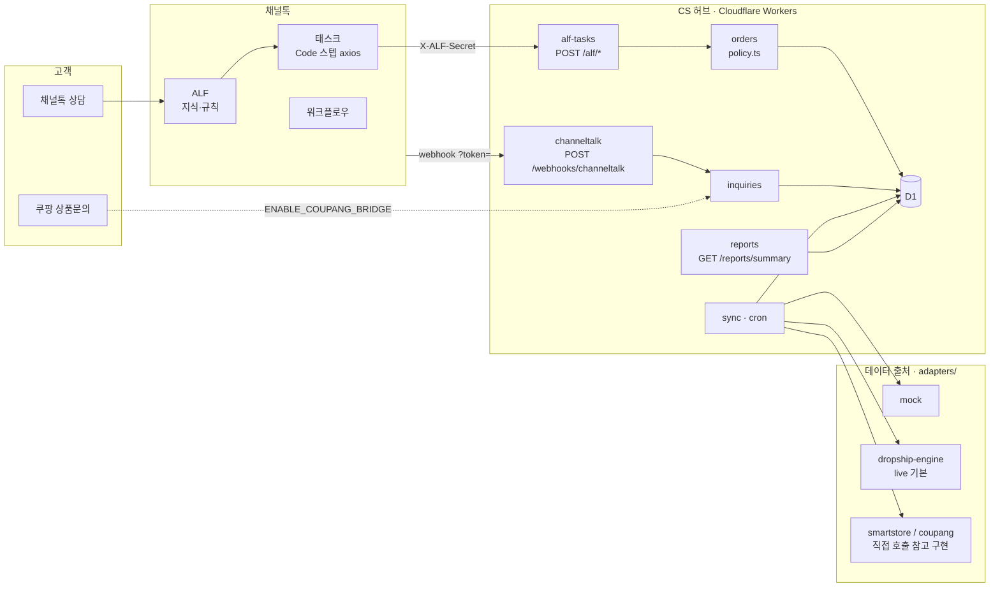
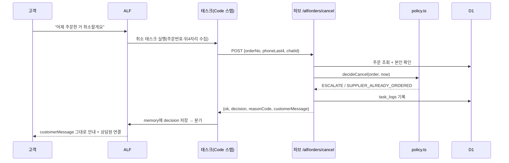
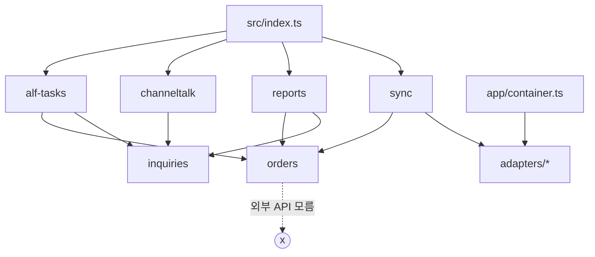

# 아키텍처

- 작성일: 2026-11-09 (Phase 0)
- 범위: 채널톡 ALF 태스크·워크플로우와 연동되는 위탁판매 CS 자동화 허브

## 1. 문제 정의

위탁판매 CS가 어려운 이유는 **고객이 보는 주문과 실제 상품이 움직이는 주문이 다르기 때문**이다.

- 고객은 스마트스토어·쿠팡에서 주문한다(판매채널 주문).
- 판매자는 그 주문을 공급처에 대신 발주하고(공급처 주문), 공급처가 송장을 낸다.
- 그래서 "취소돼요?"라는 같은 질문도 **공급처에 발주하기 전이면 바로 취소되고, 발주한 뒤면 공급처 확인이 필요하고, 출고한 뒤면 반품으로 처리해야 한다.**

ALF가 이 판단을 하려면 세 가지 주문 정보를 하나로 묶은 상태가 필요하다. 이 허브는 그 상태를 만들어 ALF 태스크가 호출하기 쉬운 API로 제공하고, 상담 결과를 쌓아 운영 지표를 만든다.

## 2. 시스템 구성



### 2.1 ALF 태스크 한 번의 흐름



## 3. 모듈 구조

```
src/
  index.ts            앱 조립(라우트 마운트) + scheduled 핸들러
  app/                env 타입, container(조립 함수), errors, logger
  modules/
    orders/           통합 주문 도메인 · policy.ts(순수 함수) · policy.config.ts
    alf-tasks/        ALF 태스크용 API · 인증 · zod 스키마
    channeltalk/      웹훅 수신 · Open API 클라이언트(인터페이스 + mock)
    inquiries/        문의 로그 · 쿠팡 문의 브릿지(플래그)
    reports/          운영 지표 집계
    sync/             판매채널·공급처 주문 동기화(cron)
  adapters/
    sales-channel/    SalesChannelAdapter: mock · engine · smartstore · coupang
    supplier/         SupplierAdapter: mock · engine
```

### 3.1 의존 방향



- 모듈끼리는 상대 모듈의 `index.ts`만 import한다.
- `orders`는 어떤 모듈도 import하지 않는다(가장 안쪽).
- 어댑터는 `container.ts`만 고른다. 모듈은 어댑터 **인터페이스 타입**만 안다.

## 4. 데이터 출처 — `DATA_SOURCE`

| 값 | 판매채널 주문 | 공급처 주문·송장 | 용도 |
|---|---|---|---|
| `mock` (기본) | `sales-channel/mock.ts` | `supplier/mock.ts` | 키 없이 전체 흐름 시연·테스트 |
| `live` | `sales-channel/engine.ts` | `supplier/engine.ts` | 실제 운영 데이터 |

**live가 판매채널을 직접 호출하지 않고 `coupang-dropship-engine`(위탁판매 운영 시스템)에서 읽는 이유:**

1. **쿠팡 OPEN API는 Wing에 등록한 IP(키당 최대 10개)에서만 호출된다.** Cloudflare Workers는 나가는 IP가 고정되지 않아 등록할 수 없다. (출처: https://developers.coupang.com/ko/getting-started/issue-open-api-keynew , 확인 2026-10-13)
2. 판매채널 주문 ↔ 공급처 주문 ↔ 송장의 연결은 이미 엔진이 관리한다. 같은 데이터를 두 곳에서 따로 수집하면 정합성 문제가 생긴다.
3. 엔진은 고객 전화번호·주소를 암호화해 저장한다. 허브는 엔진에서 `phone_last4`와 마스킹된 이름만 받아 개인정보 원문을 다루지 않는다.

`smartstore.ts`·`coupang.ts`는 "엔진 없이 판매채널을 직접 붙일 때"의 참고 구현으로 남긴다. 엔진에서 실제로 쓰고 있는 검증된 엔드포인트만 옮기고(§8), 쿠팡은 고정 IP 프록시가 필요하다는 점을 주석에 적는다.

### 4.1 엔진 연동에 필요한 것 (엔진 쪽 작업, 이 저장소 범위 밖)

- [ ] 엔진에 읽기 전용 엔드포인트 추가: 주문번호로 주문 1건(통합 상태, 송장, 공급처 발주 여부, phone_last4, 마스킹 이름) / 변경분 목록(`updatedSince`)
- [ ] 머신 토큰 인증(`Authorization: Bearer`). 엔진의 관리자 API는 로그인 + OTP라서 서버 간 호출에 쓸 수 없다
- [ ] 노출 경로: 엔진은 Mac 홈서버 + Tailscale 안에 있어 Workers에서 닿지 않는다. Cloudflare Tunnel 등으로 **이 경로만** 공개
- [ ] 엔진 응답 형식이 정해질 때까지 `engine.ts`는 인터페이스 + `TODO(verify-api)`로 둔다

### 4.2 엔진 상태 → 통합 상태 매핑 (engine.ts 안에서만 수행)

| 엔진 상태 | 통합 상태 |
|---|---|
| NEW, AWAITING_PURCHASE, PAYMENT_PENDING, OUT_OF_STOCK, MARGIN_NEGATIVE, LIMIT_EXCEEDED, SOURCE_ERROR | PAID |
| PURCHASED, SHIPPING_DELAYED, ADDRESS_CHANGED | SUPPLIER_ORDERED |
| TRACKING_UPLOADED | SHIPPED |
| IN_TRANSIT | IN_TRANSIT |
| DELIVERED, SETTLED | DELIVERED |
| CANCEL_REQUESTED / CANCELLED / RETURN_REQUESTED / RETURNED | 같은 이름 |
| MANUAL_REVIEW | `needsReview=true` 플래그 → 정책이 모든 액션을 ESCALATE |

`PAYMENT_PENDING`(공급처 주문은 만들었지만 결제 전)은 공급처 취소가 필요할 수 있다. 엔진 연동 단계에서 SUPPLIER_ORDERED로 볼지 다시 확인한다.

## 5. 도메인

### 5.1 통합 주문 상태

`PAID → SUPPLIER_ORDERED → SHIPPED → IN_TRANSIT → DELIVERED`, 예외 `CANCEL_REQUESTED · CANCELLED · RETURN_REQUESTED · RETURNED`

### 5.2 정책 (`orders/policy.ts`)

순수 함수 `decide(action, order, now, config) → { decision, reasonCode }`.
핵심 질문은 **"공급처 발주 전인가 후인가"**이다.

| 액션 | PAID | SUPPLIER_ORDERED | SHIPPED · IN_TRANSIT | DELIVERED | *_REQUESTED · CANCELLED · RETURNED |
|---|---|---|---|---|---|
| 취소 | ALLOW `CANCELABLE_BEFORE_SUPPLIER_ORDER` | ESCALATE `SUPPLIER_ALREADY_ORDERED` | DENY `ALREADY_SHIPPED` → 반품 안내 | DENY `ALREADY_DELIVERED` → 반품 안내 | DENY `CLAIM_IN_PROGRESS` / `ALREADY_CLOSED` |
| 배송지 변경 | ALLOW `ADDRESS_CHANGEABLE` | ESCALATE `SUPPLIER_ALREADY_ORDERED` | DENY `ALREADY_SHIPPED` | DENY `ALREADY_DELIVERED` | DENY |
| 반품 접수 | DENY `NOT_SHIPPED_USE_CANCEL` | DENY `NOT_SHIPPED_USE_CANCEL` | DENY `NOT_DELIVERED_YET` | 기간 내 ALLOW `RETURN_WITHIN_WINDOW` / 기간 외 ESCALATE `RETURN_WINDOW_EXPIRED` | DENY |
| 배송 조회 | `INFO` 발송 예정 안내 | `INFO` 발송 예정 안내 | `INFO` 송장 정보 | `INFO` 배송 완료 | `INFO` 진행 상태 |

- `needsReview`이면 모든 액션이 ESCALATE `MANUAL_REVIEW_REQUIRED`이다.
- 반품 기간이 지나면 DENY가 아니라 ESCALATE로 보낸다. 상품 하자는 기간이 더 길 수 있어 사람이 판단해야 하기 때문이다.
- `policy.config.ts`: `returnWindowDays: 7`(전자상거래법 제17조 청약철회 7일, 배송완료일 기준), 채널별로 다른 값을 둘 수 있게 한다.

**ALLOW의 의미 — 허브는 판매채널 API로 처리하지 않는다 (Phase 0 결정).**
ALLOW가 나오면 고객이 판매채널 앱에서 직접 처리하는 방법을 안내하고, 허브는 요청을 기록만 한다.

- 판매자가 API로 취소하면 쿠팡 판매자 점수(주문이행)가 떨어진다고 공식 문서에 적혀 있다. (https://developers.coupang.com/ko/api/shipments/cancel-an-order , 확인 2026-10-13)
- 판매자가 배송지를 바꾸는 API는 확인되지 않았다. 그래서 `address-change`는 **새 주소를 입력받지 않는다.** 주소 원문을 저장하지 않는다는 원칙과도 맞다.
- 취소·반품 요청을 받으면 허브 내부 상태를 `CANCEL_REQUESTED`·`RETURN_REQUESTED`로 표시한다. 이후 동기화가 판매채널의 실제 상태를 가져오면 그 값이 우선이다.

### 5.3 D1 스키마 (`migrations/0001_init.sql`)

프롬프트 원안에서 컬럼 세 개를 추가한다.

| 테이블 | 컬럼 | 원안 대비 |
|---|---|---|
| `sales_orders` | id, channel, channel_order_id, product_name, option_name, qty, buyer_name_masked, phone_last4, status, **needs_review**, **delivered_at**, ordered_at, updated_at | `delivered_at`: 반품 기간 계산 · `needs_review`: §4.2 |
| `supplier_orders` | id, sales_order_id, supplier_code, supplier_order_ref, status, ordered_at | — |
| `shipments` | id, sales_order_id, carrier, tracking_no, status, updated_at | — |
| `inquiries` | id, source, external_id, sales_order_id, category, handled_by, escalated, escalation_reason, created_at | — |
| `task_logs` | id, task_name, sales_order_id, **chat_id**, decision, reason_code, latency_ms, created_at | `chat_id`: 태스크 호출을 상담(`inquiries`)에 연결 |

- 유니크: `sales_orders(channel, channel_order_id)`, `inquiries(source, external_id)`
- 전화번호 전체, 실명, 주소 원문은 저장하지 않는다.
- 추가 테이블
  - `sync_state(name, cursor)`: 증분 동기화 커서(`orders`, `coupang_bridge`). 커서는 "실행을 시작한 시각"으로 저장해 실행 중 바뀐 주문을 놓치지 않는다.
  - `coupang_bridge_links(inquiry_id, chat_id, answered_at)` (`0002`): 쿠팡 문의 ↔ 브릿지가 만든 채널톡 상담. ALF 답변을 쿠팡에 되돌릴 때 쓴다.
- 동기화 upsert는 **"더 최근에 바뀐 쪽이 이긴다"**(`updated_at` 비교). 허브가 표시한 `CANCEL_REQUESTED`는 그 뒤에 바뀐 원천 데이터만 덮어쓴다.

## 6. 채널톡 연동

### 6.1 ALF 태스크 → 허브

채널톡 공식 문서로 확인한 사실 (확인 2026-11-09):

| 사실 | 설계에 주는 영향 | 출처 |
|---|---|---|
| 태스크 스텝은 AI Agent, Send Message, **Code**, Chat Action, Function, Browser Automation이다. 별도의 "API 호출" 스텝은 없다 | 허브 호출은 Code 스텝에서 한다 | https://docs.channel.io/help/en/articles/Task--2a16be8b |
| Code 스텝은 JavaScript이고 HTTP는 `axios`로 호출한다. 최대 실행 시간은 60초이다 | 응답을 빠르게 유지해야 한다. 조회는 D1 캐시에서 읽고 외부 호출은 하지 않는다 | https://developers.channel.io/en/articles/Code-node-fdcd71b4 |
| Code 스텝의 `context`로 user와 userChat을 읽을 수 있다. 결과는 `memory.put()` 뒤 `memory.save()`로 저장하고, 이후 스텝이 memory 값으로 분기한다 | 요청에 `chatId`(userChat id)를 넣는다. 응답은 평평한 구조로 만든다(`decision`, `reasonCode`, `customerMessage`) | 같은 문서 |
| 태스크 미리보기(sandbox)에서는 외부 axios 요청이 막힌다 | 실제 상담에서 검증해야 한다 → `docs/channeltalk/03-tasks.md` 체크리스트 | 같은 문서 |
| Code 스텝에 "요청 실패 시" 분기를 둘 수 있다. 분기가 없으면 태스크가 멈춘다 | 모든 태스크에 실패 분기를 두고 상담원에게 연결한다 | 태스크 문서 |
| 시크릿 저장 기능은 문서에서 찾지 못했다 | `X-ALF-Secret` 값을 Code 스텝 코드에 직접 넣어야 한다 → 허브는 이 시크릿으로 `/alf/*`만 열고, 주기적으로 교체할 수 있게 한다 | 미확인 |

### 6.2 웹훅 → 허브

| 사실 | 설계에 주는 영향 | 출처 |
|---|---|---|
| 웹훅은 `POST https://<서버>/<경로>?token=<토큰>` 형식으로 들어온다. 서명 헤더는 문서에 없다 | `?token=`을 상수 시간 비교로 검증한다 | https://developers.channel.io/en/articles/Getting-started-f2a30b58 |
| 4XX·5XX 응답은 실패로 처리되고, 100번 연속 실패하면 웹훅이 차단된다 | 처리할 수 없는 이벤트도 200으로 받고 무시한다. 검증 실패만 401로 응답한다 | 같은 문서 |
| 이벤트 종류는 Message(`personType`: user/manager/bot), UserChat, User이다 | 상담 열림·종료 이벤트는 없다 → `inquiries`는 userChat 단위로 upsert한다 | https://developers.channel.io/en/articles/Webhook-events-7bd9b8e2 |
| ALF가 처리했는지 상담원이 처리했는지 알려 주는 필드는 문서에 없다 | 아래 규칙으로 판별한다 | 미확인 |

**`handled_by`·`escalated` 판별 규칙**
- userChat에 `personType=manager` 메시지가 하나라도 있으면 `handled_by=agent`, 없으면 `alf`
- 태스크가 ESCALATE를 받았거나 상담원 메시지가 있으면 `escalated=true`
- 이관 사유: `task_logs.reason_code`(chatId로 연결). 없으면 `UNKNOWN`
- ALF가 보낸 메시지의 `personType`이 `bot`인지는 문서에 없다 → `TODO(verify-api)`. 실제 웹훅 페이로드를 받아 확인한다
- 웹훅 최상위 키(`event`, `type`, `entity`, `refers`)는 확인했지만 `entity` 안의 필드 이름(chatId, plainText, createdAt)은 문서 예시를 읽지 못해 미확인이다. 필드가 없으면 이벤트를 저장하지 않고 무시한다(`webhook.parser.ts`).
- **상담 1건 = `inquiries` 1행.** 브릿지한 쿠팡 문의는 채널톡 상담(chatId)으로만 센다. 쿠팡 고객센터 이관 문의만 `source=coupang` 행으로 남는다.

### 6.3 Open API (쿠팡 브릿지)

- Open API 문서(https://api-doc.channel.io/)는 클라이언트 렌더링이라 자동으로 읽지 못했다. 인증 헤더, base URL, 상담 생성 엔드포인트는 **미확인**이다 → `channeltalk/client.ts`는 인터페이스 + mock, live 구현은 `TODO(verify-api)`
- 쿠팡 문의 조회·답변 엔드포인트는 엔진에서 실제로 쓰고 있다(§8). 그러나 Workers에서는 IP 제약(§4) 때문에 직접 호출할 수 없다. live에서는 엔진을 거쳐야 한다.
- 브릿지 흐름(플래그 off 기본): 쿠팡 미답변 문의 → 채널톡 상담 생성 → ALF 답변 → **쿠팡에 답변 등록**(쿠팡 고객은 채널톡을 보지 못하므로 이 단계가 반드시 필요하다)
- 쿠팡 고객센터 이관 문의(`callCenterInquiries`)는 쿠팡 상담원이 넘긴 급한 건이므로 브릿지 대상에서 제외하고 사람이 처리한다(엔진의 운영 규칙과 같음)

## 7. API 요약

| 메서드 | 경로 | 인증 | 설명 |
|---|---|---|---|
| POST | `/alf/orders/lookup` | `X-ALF-Secret` | orderNo + phoneLast4 → 상태·배송 정보 |
| POST | `/alf/orders/cancel` | `X-ALF-Secret` | orderNo + phoneLast4 |
| POST | `/alf/orders/address-change` | `X-ALF-Secret` | orderNo + phoneLast4 (새 주소는 받지 않음) |
| POST | `/alf/orders/return-request` | `X-ALF-Secret` | orderNo + phoneLast4 + reason |
| POST | `/webhooks/channeltalk?token=` | query token | 상담 이벤트 적재 |
| GET | `/reports/summary?from=&to=[&format=md]` | `X-Admin-Secret` | 운영 지표(JSON 또는 마크다운 표) |
| GET | `/health` | 없음 | 상태·데이터 출처 |

- **본인 확인 (Phase 0 결정):** 모든 `/alf/*`는 `orderNo`와 `phoneLast4`를 **둘 다** 받는다. 뒤 4자리만으로 조회하는 방식은 경우의 수가 1만 개뿐이라 남의 주문을 쉽게 볼 수 있어서 넣지 않았다.
- 주문이 없을 때와 뒤 4자리가 틀렸을 때 **같은 응답**(`ORDER_NOT_FOUND`)을 준다. 주문번호가 존재하는지 알려 주지 않기 위해서다.
- 공통 응답: `{ ok, decision, reasonCode, customerMessage, data }`. `decision`은 `ALLOW | ESCALATE | DENY | INFO`이다(조회는 `INFO`).

## 8. 외부 API 확인 현황

| 대상 | 내용 | 상태 | 출처 / 확인일 |
|---|---|---|---|
| 쿠팡 인증 | HMAC-SHA256, `Authorization: CEA algorithm=HmacSHA256, access-key, signed-date, signature` | 확인 | https://developers.coupang.com/ko/getting-started/creating-hmac-signature (2026-10-13) |
| 쿠팡 IP 제약 | 허용 IP 키당 최대 10개, 샌드박스 없음 | 확인 | https://developers.coupang.com/ko/getting-started/issue-open-api-keynew (2026-10-13) |
| 쿠팡 발주서 | `GET /v2/providers/openapi/apis/api/v5/vendors/{vendorId}/ordersheets`, 상태 ACCEPT·INSTRUCT·DEPARTURE·DELIVERING·FINAL_DELIVERY | 확인·운영 중 | https://developers.coupang.com/ko/api/shipments/po-list-query-by-minute (2026-10-13) |
| 쿠팡 상품문의 | 조회 `GET …/v5/vendors/{vendorId}/onlineInquiries`, 답변 `POST …/v4/vendors/{vendorId}/onlineInquiries/{id}/replies` | 운영 중(엔진) | https://developers.coupang.com/ko/api (2026-10-13) |
| 쿠팡 고객센터 문의 | `GET …/v4/vendors/{vendorId}/callCenterInquiries` | 실측 200 (2026-10-14) | 엔진 |
| 스마트스토어 인증 | `POST /external/v1/oauth2/token`, `client_secret_sign = base64(bcrypt(clientId_timestamp, clientSecret))`, 3시간 유효 | 확인·운영 중 | https://apicenter.commerce.naver.com/docs/commerce-api/current (2026-10-15) |
| 스마트스토어 주문 | `GET /v1/pay-order/seller/product-orders/last-changed-statuses`, `POST …/product-orders/query` | 확인·운영 중 | 위와 같음 |
| 스마트스토어 문의 | `GET /v1/pay-user/inquiries`, `POST /v1/pay-merchant/inquiries/{no}/answer`, 상품 Q&A `GET /v1/contents/qnas` | 확인·운영 중 | 위와 같음 |
| 스마트스토어 IP 제약 | 호출 IP 등록이 필요한지 | **미확인** | — |
| 채널톡 태스크 Code 스텝 | §6.1 | 확인 | §6.1 |
| 채널톡 웹훅 | §6.2 | 확인 | §6.2 |
| 채널톡 Open API | 인증, 상담 생성 | **미확인** | — |
| dropship-engine 연동 API | §4.1 | **아직 없음** | — |

- 스마트스토어 서명에는 bcrypt가 필요하다. live에서 직접 호출 구현이 필요해질 때 `bcryptjs` 추가 여부를 사용자에게 묻는다(지금은 엔진 경유라 필요 없음).

## 9. 보안

- `/alf/*`: `X-ALF-Secret` 상수 시간 비교. `/reports/*`: 별도의 `X-Admin-Secret`. 웹훅: `?token=`. 세 값은 서로 다르게 두고 `wrangler secret`으로 관리한다.
- 로그 마스킹: 전화번호(`010-****-1234`), 이름(`김*수`), 주소(시·구까지만).
- 요청 본문 크기 제한, zod `strict()` 스키마로 모르는 필드는 거부한다.

## 10. 범위 밖

프론트엔드 대시보드, 공급처 크롤링·자동 발주, 판매채널 API로 실제 취소·변경 실행, 인증 시스템·멀티 테넌시·큐.

## 11. 결정 기록

| # | 결정 | 이유 |
|---|---|---|
| D1 | live 데이터는 dropship-engine에서 읽는다 | Workers 고정 IP 없음(쿠팡 허용 IP 제약), 주문-발주-송장 연결의 단일 출처 |
| D2 | ALLOW = 고객 직접 처리 안내 + 요청 기록 | 판매자 API 취소는 쿠팡 판매자 점수를 깎음, 배송지 변경 API 미확인, 주소 원문 미저장 |
| D3 | 모든 `/alf/*`에 orderNo + phoneLast4 필수 | 뒤 4자리 단독 조회는 남의 주문을 쉽게 볼 수 있음 |
| D4 | lint/format은 Biome | 의존성 1개, 설정 파일 1개 |
| D5 | 스크립트는 `node scripts/x.ts`(Node 24 기본 TS 실행) | tsx 의존성 불필요 |
| D6 | `decision`에 `INFO` 추가 | 배송 조회는 허용·거부할 대상이 아님 |
| D7 | 반품 기간이 지나면 DENY가 아니라 ESCALATE | 상품 하자 반품은 기간이 다를 수 있어 사람이 판단 |
| D8 | 주문 없음(`ORDER_NOT_FOUND`)은 HTTP 200 | 고객 입력 실수는 업무상 정상 결과. ALF가 "요청 실패" 분기가 아니라 재질문으로 가게 한다 |
| D9 | 반품 사유는 자유 문장이 아니라 분류(`CHANGE_OF_MIND·DEFECT·WRONG_ITEM·OTHER`) | 자유 문장에는 개인정보가 섞이기 쉽다. 하자·오배송은 정책이 ESCALATE |
| D10 | 테스트는 `@cloudflare/vitest-plugin`(Workers 런타임) | 기존 `vitest-pool-workers`가 이 이름으로 바뀌고 deprecated 됨 |
| D11 | 쿠팡 브릿지 연결 테이블(`0002`) | 쿠팡 고객은 채널톡을 못 보므로 ALF 답변을 쿠팡에 되돌려야 하고, 그러려면 상담↔문의 연결이 필요 |
| D12 | 브릿지는 자체 포트(`ChatCreator`)만 안다 | channeltalk → inquiries 한 방향 의존 유지(순환 방지) |
| D13 | 지식 원문의 운영자 메모는 빌드 때 제거 + 금지어 검사 | 위탁 내부 사정이 ALF 답변으로 새는 것을 기계적으로 막는다 |

## 12. 알려진 한계

| 한계 | 영향 | 개선 방향 |
|---|---|---|
| 주문번호 1개 = 상품 1줄로 단순화 | 여러 상품을 한 번에 주문하면 대표 상품만 보인다 | `sales_orders`를 상품주문 단위로 나누고 lookup이 목록을 반환 |
| 판매채널 수취인 번호가 안심번호일 수 있음 | 뒤 4자리가 고객이 아는 번호와 달라 본인 확인 실패 | 엔진에서 주문자 번호 기준 `phone_last4` 제공(엔진 계약에 포함) |
| 브릿지는 첫 bot/manager 메시지를 쿠팡 답변으로 등록 | ALF가 메시지를 나눠 보내면 답변이 잘린다 | 실제 상담 확인 후 "답변 확정" 기준(태그·종료) 도입 |
| mock 데이터 시각이 실행 시점 기준 상대값 | seed 후 며칠 지나면 반품 기간 판단이 바뀐다 | 테스트 전 `npm run seed` 다시 실행 |
