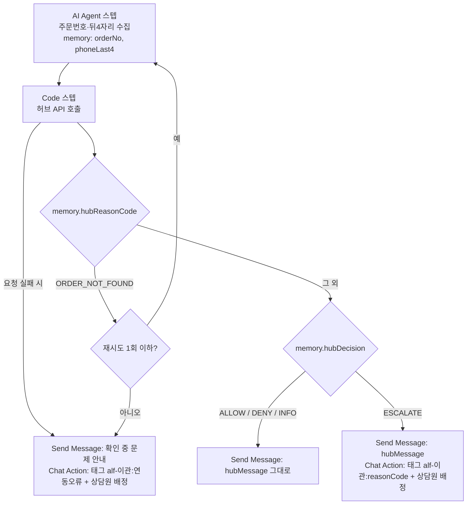

# 03. ALF 태스크

허브 API를 호출하는 태스크 4개의 트리거·단계·분기와, 실제로 확인해야 할 체크리스트다.

## 채널톡 태스크에 대해 확인한 사실 (공식 문서, 확인 2026-11-09)

| 사실 | 출처 |
|---|---|
| 태스크 스텝: AI Agent, Send Message, Code, Chat Action, Function, Browser Automation | https://docs.channel.io/help/en/articles/Task--2a16be8b |
| 외부 API는 **Code 스텝**에서 JavaScript + `axios`로 호출, 최대 60초 | https://developers.channel.io/en/articles/Code-node-fdcd71b4 |
| Code 스텝 함수 형식 `export const handler = async (memory, context, isSandbox) => {}` | https://developers.channel.io/en/categories/FrontALF-e2986e0d |
| `memory.get(key)`, `memory.put(key, value)`, `memory.save()` — save를 안 부르면 저장 안 됨 | Code 스텝 문서 |
| `context`에는 user(고객)와 userChat(상담) 정보가 있고 읽기 전용 | Code 스텝 문서 |
| 태스크 미리보기(sandbox)에서는 외부 axios 요청이 막힌다 | Code 스텝 문서 |
| Code 스텝에 "요청 실패 시" 분기를 둘 수 있고, 없으면 실패 시 태스크가 멈춘다 | 태스크 문서 |
| 이후 스텝은 memory 값으로 분기한다 | 태스크 문서 |

**확인하지 못한 것(실제 태스크에서 확인)**: `axios`를 꺼내는 방법(require / 전역), `context` 안 상담 ID의 정확한 경로, 어떤 경우가 "요청 실패"로 처리되는지(throw / HTTP 4xx·5xx).

## 공통 구조



- 허브 응답 `200`은 모두 판단 결과다(주문 없음 포함). 연동 문제(`400/401/5xx`)만 "요청 실패 시"로 간다.
- ESCALATE에 붙이는 태그는 워크플로우(`04-workflows.md`)가 상담원 배정·알림에 쓴다.

## Code 스텝 코드 — 손으로 쓰지 않고 생성한다

```bash
npm run task-code -- --url https://<허브 주소>
# → dist/channeltalk/00-ping.js … 04-return-request.js, webhook-url.txt
```

허브 주소(임시 터널)와 `ALF_SECRET`을 채운 코드 5개를 만든다. 터널 주소가 바뀌면 다시 생성해 붙여넣는다.
생성 로직은 `scripts/lib/task-code.ts`, 테스트는 `tests/scripts/task-code.test.ts`(문법·형식·sandbox 분기 실행까지 확인).

생성되는 코드의 모양(주문 취소 예시, 값은 생성 시 채워짐):

```js
export const handler = async (memory, context, isSandbox) => {
  if (isSandbox) {
    // 태스크 미리보기에서는 외부 요청이 막혀 있어 분기만 확인한다
    memory.put('hubDecision', 'INFO');
    memory.put('hubReasonCode', 'SANDBOX');
    memory.put('hubMessage', '(미리보기) 실제 상담에서 허브를 호출합니다.');
    memory.save();
    return;
  }

  const body = {
    orderNo: String(memory.get('orderNo') ?? ''),
    phoneLast4: String(memory.get('phoneLast4') ?? ''),
    chatId: context.userChat?.id,
  };

  // 400/401/5xx는 axios가 예외를 던진다 → Code 스텝의 "요청 실패 시" 분기로 간다
  const res = await axios.post('https://<허브 주소>/alf/orders/cancel', body, {
    headers: { 'X-ALF-Secret': '<ALF_SECRET>' },
    timeout: 10000,
  });

  memory.put('hubOk', res.data.ok);
  memory.put('hubDecision', res.data.decision);
  memory.put('hubReasonCode', res.data.reasonCode);
  memory.put('hubMessage', res.data.customerMessage);
  memory.put('hubStatusLabel', res.data.data?.order?.statusLabel ?? '');
  memory.save();
};
```

- **시크릿을 코드에 직접 넣는 이유**: 채널톡 Code 스텝의 시크릿 저장 기능을 문서에서 찾지 못했다. 그래서 `ALF_SECRET`은 `/alf/*`만 열 수 있게 분리했다(리포트·웹훅 시크릿과 다름). 바꾸려면 `npm run setup -- --force` → 허브 재시작 → `npm run task-code` → 5개 태스크에 다시 붙여넣기.
- **로컬 검증**: 생성한 코드를 채널톡 Code 스텝과 같은 조건(전역 axios, memory.get/put/save, 숫자 chatId)으로 Node에서 실행해 터널 주소로 호출하고, 5개 모두 기대 결과·실패 분기(401 → 예외)를 확인했다(2026-11-09).

## T0. 연결 확인 (`/alf/ping`) — 주문 태스크보다 먼저

| 항목 | 내용 |
|---|---|
| 목적 | Code 스텝에서 axios 호출·시크릿·상담 ID 경로가 맞는지 확인 |
| 트리거 | "연결 테스트" (운영에서는 끄거나 지운다) |
| 스텝 | Code(`00-ping.js`) → Send Message(`hubMessage`) / 실패 시 "허브 연결 실패" |
| 기대 | `허브 연결 정상 (chatId: …)` — chatId가 "없음"이면 `context.userChat.id` 경로가 다른 것 |

## 태스크별 설정

### T1. 주문 조회 (`/alf/orders/lookup`)

| 항목 | 내용 |
|---|---|
| 트리거(ALF가 이 태스크를 쓰는 때) | "언제 와요", "배송 조회", "출고됐나요", "송장번호" 등 특정 주문의 상태를 묻는 경우 |
| 수집 | 주문번호, 휴대폰 뒤 4자리 |
| 결과 | `INFO` + 상태 안내(출고 준비 중 / 배송 중 + 송장 / 배송 완료 / 취소·반품 진행) |
| 이관 | `MANUAL_REVIEW_REQUIRED`(원천 데이터 확인 필요) |

### T2. 주문 취소 (`/alf/orders/cancel`)

| 항목 | 내용 |
|---|---|
| 트리거 | "취소해 주세요", "주문 취소" |
| 결과 | 발주 전 `ALLOW`(고객이 앱에서 직접 취소하도록 안내) / 발주 후 `ESCALATE` / 출고 후 `DENY`(반품 안내) |
| 주의 | 허브는 판매채널 API로 취소하지 않는다(쿠팡 판매자 점수 하락). 안내 후 허브에 '취소 요청'만 표시 |

### T3. 배송지 변경 (`/alf/orders/address-change`)

| 항목 | 내용 |
|---|---|
| 트리거 | "주소 바꿀래요", "배송지 변경" |
| 수집 | 주문번호, 뒤 4자리 (**새 주소는 받지 않는다**) |
| 결과 | 발주 전 `ALLOW`(앱에서 직접 변경 안내) / 발주 후 `ESCALATE` / 출고 후 `DENY` |

### T4. 반품 접수 (`/alf/orders/return-request`)

| 항목 | 내용 |
|---|---|
| 트리거 | "반품", "환불하고 싶어요", "불량이에요", "다른 상품이 왔어요" |
| 수집 | 주문번호, 뒤 4자리, 사유 분류(AI Agent가 고객 말을 `CHANGE_OF_MIND / DEFECT / WRONG_ITEM / OTHER` 중 하나로 분류해 memory `returnReason`에 저장) |
| 결과 | 배송완료 7일 이내 단순 변심 `ALLOW` / 하자·오배송 `ESCALATE`(사진 요청) / 기간 경과 `ESCALATE` / 출고 전 `DENY`(취소로 안내) |

<!-- screenshot: 취소 태스크 편집 화면(스텝·분기) -->

## 검증 체크리스트 — 태스크

로컬 허브 + 임시 터널(`docs/setup-guide.md` 3단계)과 `npm run seed` 주문으로 실제 상담 창에서 확인한다.

- [ ] T0 연결 확인: `허브 연결 정상 (chatId: …)`가 오는가(axios·시크릿 확인)
- [ ] T0의 chatId가 웹훅 로그의 상담 ID와 같은가(같아야 태스크 결과가 상담 리포트에 연결된다)
- [ ] 시크릿을 틀리게 넣으면 "요청 실패 시" 분기로 가는가(401이 실패로 처리되는지)
- [ ] 주문번호를 틀리게 말하면 다시 묻는가(200 + `ORDER_NOT_FOUND` → 재수집)
- [ ] `hubMessage`가 고쳐지지 않고 그대로 나가는가
- [ ] ESCALATE 때 태그가 붙고 상담원이 배정되는가
- [ ] 응답 시간: `npm run report`의 평균 응답(ms)이 1,000ms 미만인가

## 검증 체크리스트 — 쿠팡 문의 브릿지 (`ENABLE_COUPANG_BRIDGE`, 기본 off)

브릿지는 인터페이스와 mock만 구현되어 있다. 켜기 전에 아래를 직접 확인한다.

- [ ] 채널톡 Open API 키 발급 위치와 인증 헤더 이름(문서 미확인 → `src/modules/channeltalk/client.ts` TODO)
- [ ] Open API로 **외부 문의를 고객 메시지로 담은 상담**을 만들 수 있는가(확인된 것은 그룹 메시지 전송뿐)
- [ ] 그렇게 만든 상담에 **ALF가 실제로 응답하는가**(ALF는 고객이 연 상담에만 반응할 수 있음)
- [ ] ALF 답변이 웹훅 Message 이벤트(`personType=bot`)로 들어오는가, 메시지가 여러 개로 나뉘는가(지금은 첫 답변만 쿠팡에 등록)
- [ ] 쿠팡 답변 등록이 dropship-engine 경유로 동작하는가(Workers는 쿠팡 허용 IP에 등록할 수 없음)
- [ ] 쿠팡 상품문의 답변 정책(외부 채널 유도 금지 등)에 어긋나는 문장이 없는가
- [ ] 쿠팡 고객센터 이관 문의는 브릿지되지 않고 상담원 이관으로만 기록되는가(mock 테스트로는 확인됨)

하나라도 안 되면 브릿지는 끄고, 쿠팡 문의는 dropship-engine의 템플릿 답변 + 사람 답변으로 운영한다.
