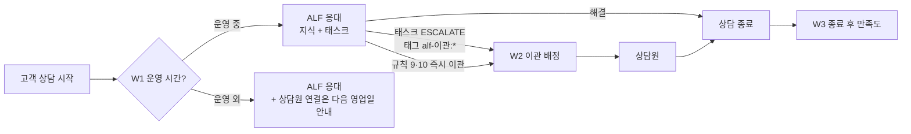

# 04. 워크플로우

채널톡 워크플로우 설정 기록이다. 설정을 바꾸면 이 표를 같이 고친다.
메뉴 이름·설정 항목은 실제 화면 기준으로 채운다(아래 "설정 값" 칸).

## 상담 흐름 전체

## 워크플로우 목록

| # | 이름 | 시작 조건 | 동작 | 목적 | 설정 값 |
|---|---|---|---|---|---|
| W1 | 운영 시간 안내 | 상담 시작 | 운영 시간 외면 "상담원 연결은 운영 시간에 이어서 안내" 메시지 | 이관 후 무응답 시간에 대한 불만 방지 | |
| W2 | ALF 이관 배정 | 태그 `alf-이관:*`가 붙음 | 담당 상담원 배정 + 내부 알림. 태그의 사유 코드로 우선순위 구분(`SUPPLIER_ALREADY_ORDERED`는 공급처 확인이 필요해 빠르게) | ALF가 넘긴 상담이 방치되지 않게 | |
| W3 | 종료 후 만족도 | 상담 종료 | 만족도 질문 1개 | v1→v2 비교 지표 | |
| W4 | 쿠팡 브릿지 상담 표시 | (브릿지 켰을 때) 브릿지가 만든 상담 | 태그 `coupang-qna` | 쿠팡 문의를 따로 집계 | |

## 이관 태그 규칙

태스크 Code 스텝 다음 Chat Action에서 `alf-이관:<reasonCode>` 태그를 붙인다.

| 태그 | 의미 | 상담원이 할 일 |
|---|---|---|
| `alf-이관:SUPPLIER_ALREADY_ORDERED` | 발주 후 취소·배송지 변경 요청 | 공급처에 출고 중지·주소 변경 가능 여부 확인 → 고객 안내 |
| `alf-이관:RETURN_NEEDS_INSPECTION` | 불량·오배송 반품 | 사진 확인 → 반품비 부담 판단 |
| `alf-이관:RETURN_WINDOW_EXPIRED` | 반품 기간 경과 | 예외 허용 여부 판단 |
| `alf-이관:MANUAL_REVIEW_REQUIRED` | 원천 주문 데이터 확인 필요 | dropship-engine 예외함 확인 |
| `alf-이관:연동오류` | 허브 호출 실패 | 허브 `/health`·Workers 로그 확인 후 직접 응대 |

<!-- screenshot: W2 워크플로우 설정 화면 -->

## 변경 이력

| 날짜 | 워크플로우 | 변경 | 이유 |
|---|---|---|---|
| | | 최초 설정 | |
